# Rekenportal

Een frontend-only webapplicatie voor kinderen (groep 5) om te oefenen met rekenen.
Geen backend, geen build-stap, geen frameworks: alleen HTML, CSS en vanilla
JavaScript (ES modules). Werkt volledig offline door `index.html` te openen.

## Screenshots

| | |
|---|---|
| 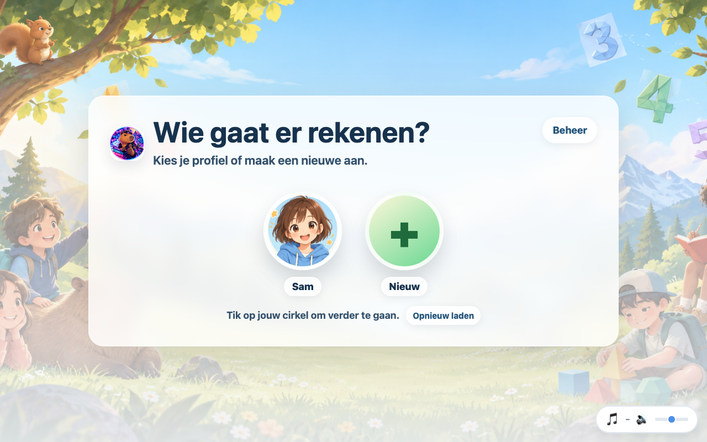<br>Profielkiezer (naam + avatar, geen wachtwoord) | 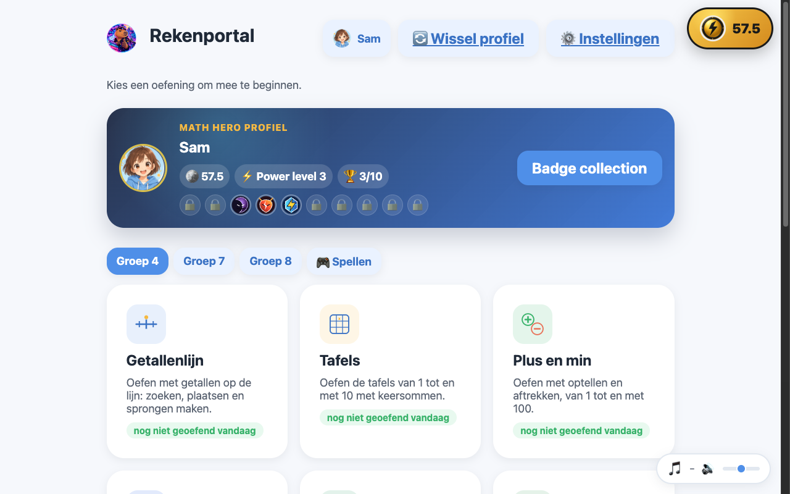<br>Home met oefeningen per groep |
| 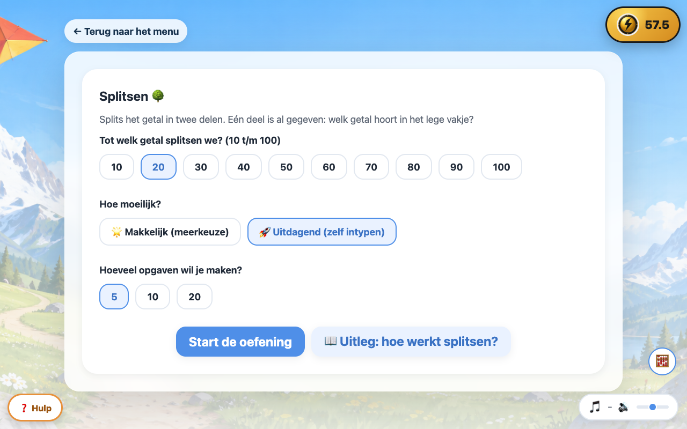<br>Splitsen: bereik 10 t/m 100 kiezen | 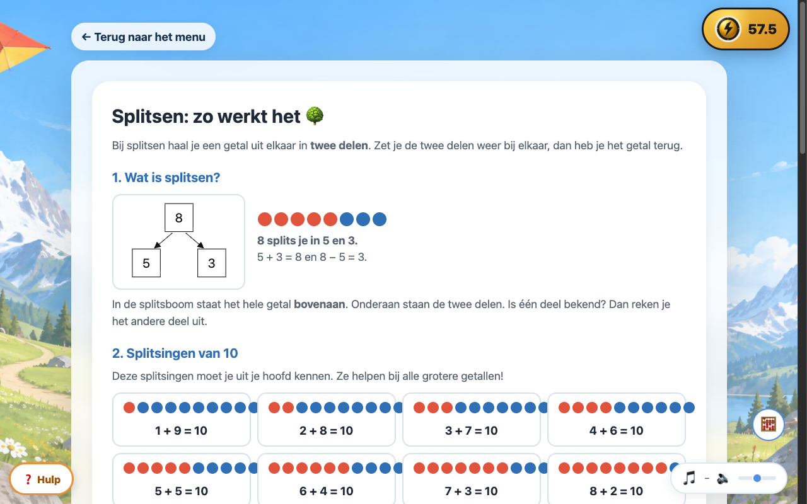<br>Uitlegpagina met plaatjes |
| 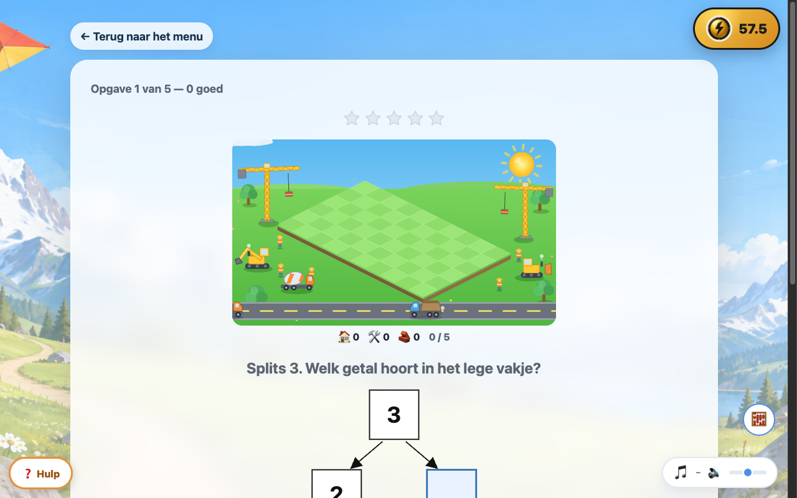<br>Splitsboom met Math City-voortgang | 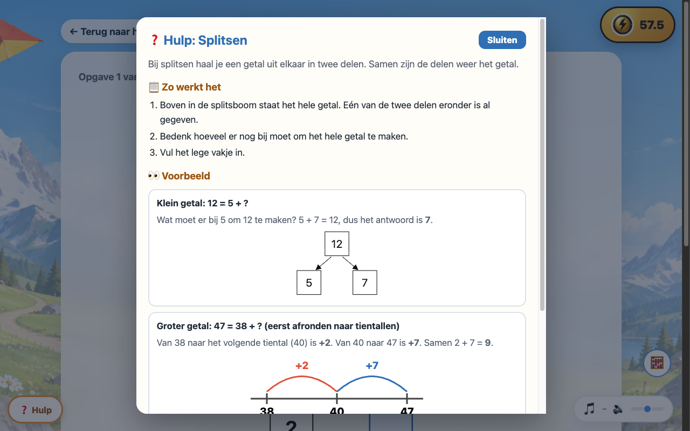<br>Hulp-knop: uitleg, voorbeeld en tips |
| 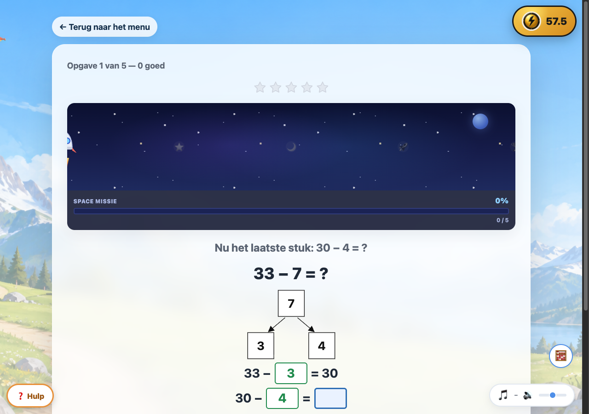<br>Sommen via het tiental: stap 3 van 3 | 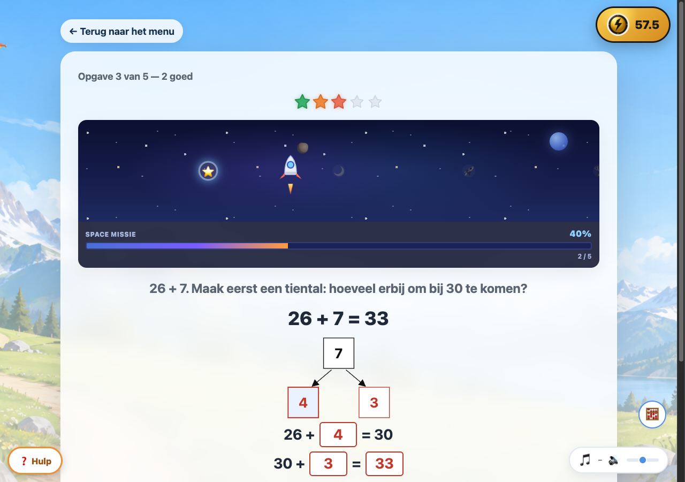<br>Na twee foute pogingen: de oplossing in rood |
| 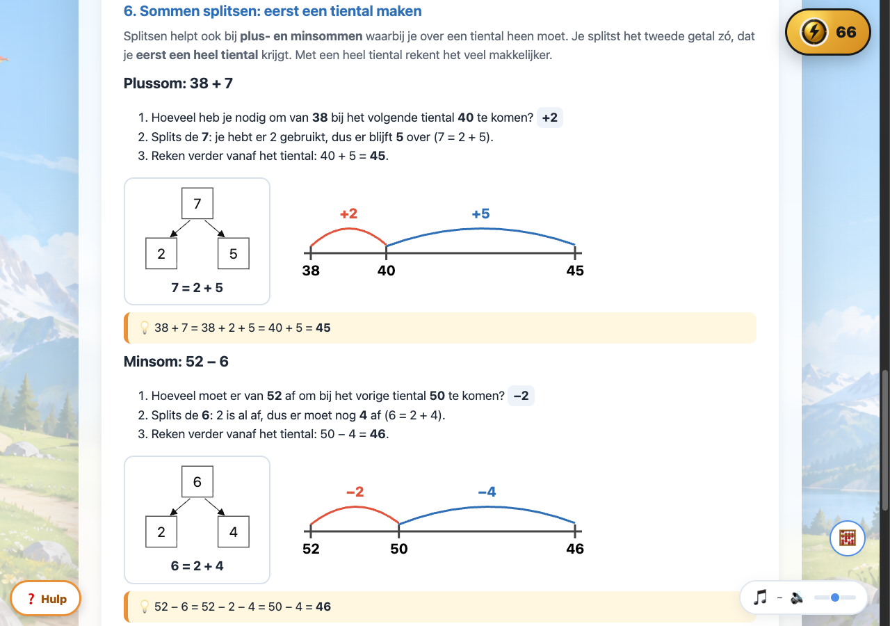<br>Uitleg: plus- en minsommen via het tiental | |
| 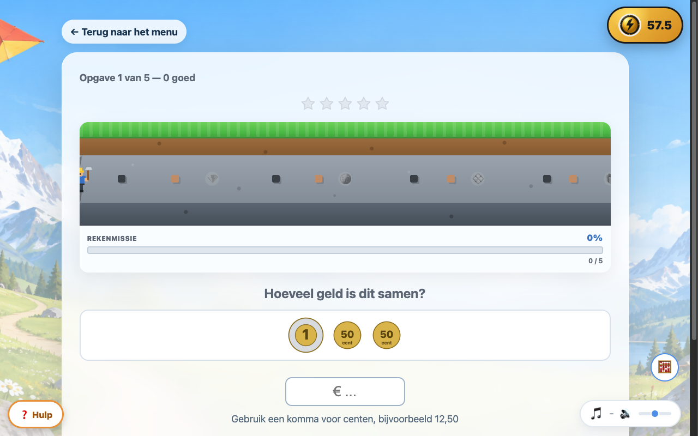<br>Rekenen met geld | 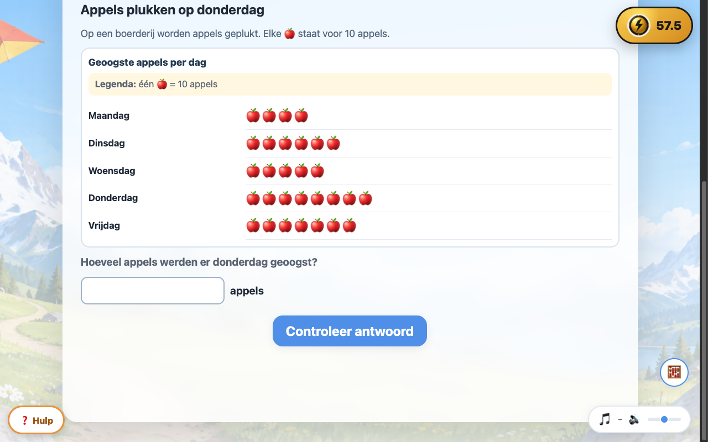<br>Grafieken lezen (groep 8) |
| 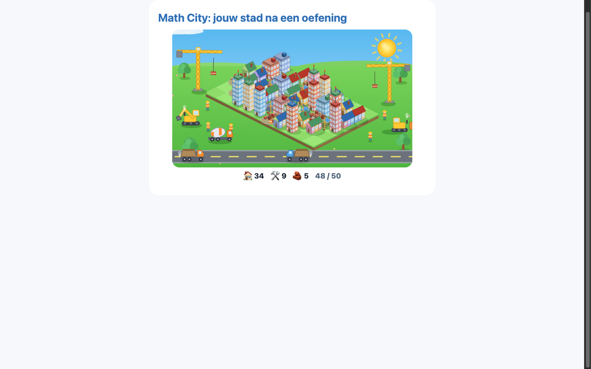<br>Math City na een oefening | 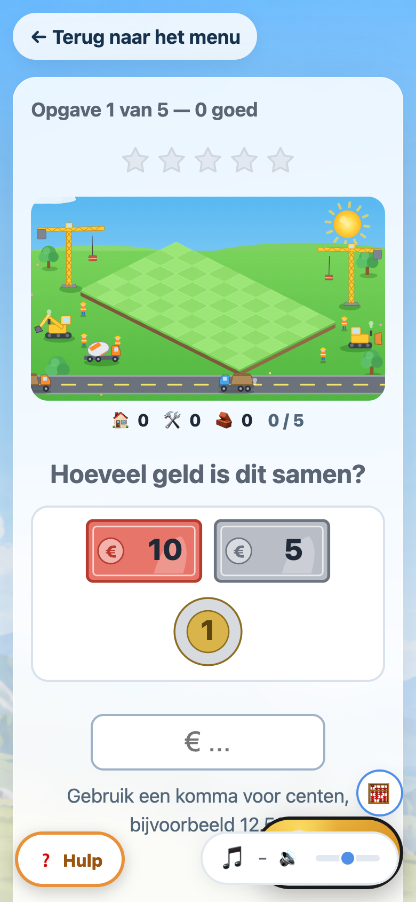<br>Mobiele weergave |

## Bestandsstructuur

```
rekenportal/
├── index.html                     # Enige HTML-pagina, laadt js/main.js
├── README.md
├── css/
│   └── stijl.css                  # Design system: CSS-variabelen + alle stijlen
└── js/
    ├── main.js                    # Kleine hash-router (#/, #/oefening/<id>, ...)
    ├── exercises.js                # ⭐ CENTRAAL REGISTER van alle oefeningen
    ├── storage.js                  # ⭐ ENIGE plek die met localStorage praat
    ├── screens/
    │   ├── home.js                 # Homepage: genereert tegels uit exercises.js
    │   ├── oefeningScherm.js       # Generiek scherm dat een oefening "mount"
    │   ├── statistieken.js         # Statistiekenscherm
    │   └── instellingen.js         # Algemene instellingen (bv. geluid aan/uit)
    ├── utils/
    │   ├── willekeurig.js          # Random getallen + voorkomen van herhaling
    │   ├── complimenten.js         # Wisselende Nederlandse complimenten/foutmeldingen
    │   ├── geluid.js                # Kleine geluidjes via Web Audio API
    │   ├── raketAnimatie.js        # Motiverende raket-naar-de-maan animatie
    │   ├── getallenlijnSvg.js      # SVG-tekenfuncties voor de getallenlijn
    │   ├── grafiekSvg.js           # SVG-grafiek voor de statistieken
    │   └── iconen.js                # Zelfgetekende SVG-icoontjes voor de tegels
    └── exercises/
        ├── getallenlijn/           # Module 1: de getallenlijn
        │   ├── index.js            # mount() + registratie-object
        │   ├── instelscherm.js     # Instelscherm (bereik, stap, aantal, type)
        │   ├── oefenscherm.js      # Het daadwerkelijke oefenen + feedback
        │   └── opgaven.js          # Rekenlogica: genereert de 5 opgavetypes
        ├── tafels/                 # Module 2: de tafels van 1 t/m 10
        │   ├── index.js            # mount() + registratie-object
        │   ├── instelscherm.js     # Instelscherm (welke tafel(s), aantal opgaven)
        │   ├── oefenscherm.js      # Het daadwerkelijke oefenen + feedback
        │   └── opgaven.js          # Rekenlogica: genereert keersommen
        ├── plusmin/                # Module 3: plus en min tot 100
        │   ├── index.js            # mount() + registratie-object
        │   ├── instelscherm.js     # Instelscherm (bereik, plus/min/beide, aantal)
        │   ├── oefenscherm.js      # Het daadwerkelijke oefenen + feedback
        │   └── opgaven.js          # Rekenlogica: genereert plus- en minsommen
        └── verhaaltjes/            # Module 4: verhaaltjessommen tot 10
            ├── index.js            # mount() + registratie-object
            ├── instelscherm.js     # Instelscherm (aantal opgaven)
            ├── oefenscherm.js      # Het daadwerkelijke oefenen + feedback
            └── opgaven.js          # Verhaaltjes-sjablonen + generatielogica
```

## Hoe werkt de architectuur?

- **`storage.js`** is de enige module die `localStorage` aanroept. Elke oefening
  levert resultaten aan via **`recordAnswer({ exerciseId, correct, timeMs, meta })`**.
  Daardoor werken de statistieken automatisch voor élke oefening, en kunnen we
  later `storage.js` vervangen door een versie die met een Flask/SQLite-backend
  praat (bv. via `fetch()`), zonder dat er iets in de oefeningen zelf verandert.
- **`exercises.js`** is het centrale register. De homepage (`screens/home.js`)
  genereert de menutegels automatisch uit deze lijst. Oefeningen weten niets van
  elkaar en delen geen state — de enige gedeelde interface is `recordAnswer()`.
- Elke oefening levert een object met: `id`, `titel`, `omschrijving`, `icoonSvg`
  (inline SVG-string), `kleurthema` (hex-kleur), `instelbareOpties` (korte tekst)
  en een `mount(container, settings)`-functie die de hele oefening in de
  meegegeven container tekent.

## Zo voeg je een nieuwe oefening toe (stap voor stap)

Stel je wilt een oefening "Klokkijken" toevoegen.

1. **Maak een map** `js/exercises/klokkijken/` met minstens een `index.js`.
2. **Schrijf de `mount`-functie** die de oefening in de gegeven `container`
   tekent, bijvoorbeeld:

   ```js
   // js/exercises/klokkijken/index.js
   import { recordAnswer } from "../../storage.js";

   export function mount(container, settings) {
     container.innerHTML = "<p>Hier komt de klok-oefening...</p>";
     // Gebruik recordAnswer({ exerciseId: "klokkijken", correct, timeMs, meta })
     // telkens als het kind een opgave heeft beantwoord.
   }

   export const klokkijkenOefening = {
     id: "klokkijken",
     titel: "Klokkijken",
     omschrijving: "Oefen met hele en halve uren.",
     icoonSvg: `<svg viewBox="0 0 64 64" width="40" height="40" aria-hidden="true">
       <circle cx="32" cy="32" r="28" fill="none" stroke="#4f8fe8" stroke-width="4" />
     </svg>`,
     kleurthema: "#4f8fe8",
     mount,
   };
   ```

3. **Registreer de oefening** in `js/exercises.js`: importeer het object en zet
   het in de `EXERCISES`-lijst.

   ```js
   import { klokkijkenOefening } from "./exercises/klokkijken/index.js";

   export const EXERCISES = [
     // ...bestaande oefeningen...
     { ...klokkijkenOefening, instelbareOpties: "Hele/halve uren" },
   ];
   ```

4. **Klaar.** De tegel verschijnt automatisch op de homepage, met icoon, titel,
   omschrijving en een voortgangsindicatie ("vandaag X goed") — zonder dat je
   iets aan `home.js`, `statistieken.js` of andere bestanden hoeft aan te passen.
   Zodra de oefening via `recordAnswer()` resultaten doorgeeft, werkt het
   statistiekenscherm er ook automatisch voor.

Zie `js/exercises/plusmin/index.js` voor een compact voorbeeld met een eigen
instelscherm (bereik + bewerkingskeuze), en `js/exercises/getallenlijn/` voor
een volledig uitgewerkt voorbeeld met meerdere opgavetypes en SVG-tekenwerk.

## Opslag en later overstappen naar een backend

Alles wordt nu bewaard in `localStorage`, via `storage.js`:
- `recordAnswer(...)` — slaat één beantwoorde opgave op.
- `getStatistiekOverzicht(exerciseId?)` — totalen, streaks, gemiddelde tijd.
- `getDagelijkseStatistieken(dagen, exerciseId?)` — data voor de 14-dagen-grafiek.
- `getUitsplitsingPerVeld(exerciseId, veldNaam)` — bv. percentage goed per stapgrootte.
- `getInstellingen(exerciseId)` / `saveInstellingen(exerciseId, instellingen)`.
- `getAlgemeneInstellingen()` / `saveAlgemeneInstellingen(instellingen)`.
- `wisAlleStatistieken()`.

Wil je later Flask + SQLite gebruiken? Vervang de binnenkant van deze functies
door `fetch()`-aanroepen naar je API. De rest van de app (oefeningen, schermen)
blijft ongewijzigd, omdat die alleen deze functies aanroepen en niet weten hoe
de data daadwerkelijk wordt opgeslagen.

## Starten

Geen build-stap nodig. Open gewoon `index.html` in de browser, of start een
kleine lokale webserver (nodig omdat ES modules niet altijd werken via
`file://` in elke browser):

```bash
cd rekenportal
python3 -m http.server 8000
# open http://localhost:8000 in de browser
```

## Installeren op Unraid

De app draait als Docker-container (`ghcr.io/jayvenco/rekenportal`, poort 8420,
data in `/app/backend/data`). Een GitHub Action bouwt de image bij elke push.
Er zijn geen geheimen of omgevingsvariabelen nodig.

**Installeren of bijwerken met het script** (als root op de Unraid-server):

```bash
curl -fsSL https://raw.githubusercontent.com/jayvenco/rekenportal/staging/scripts/install-unraid.sh | bash
```

Het script maakt `/mnt/user/appdata/rekenportal/data` aan, bewaart bij een
update eerst een backup van de database in `data/backups/`, pullt de image,
start de container `rekenportal` met de Unraid-labels (icoon en WebUI-knop) en
zet het template in `/boot/config/plugins/dockerMan/templates-user/`. Daarna
verschijnt de container in de **Docker-tab** met icoon en WebUI-link en kun je
**Edit**, **Check for Updates** en **Apply Update** gebruiken. Opnieuw draaien is
veilig: de data blijft staan.

Aanpassen kan met omgevingsvariabelen voor het script, bijvoorbeeld
`PORT=8430 APPDATA=/mnt/user/appdata/rekenportal bash install-unraid.sh`.
Andere opties: `IMAGE_TAG` (standaard `staging`), `BRANCH` en, voor een privé
image, `GHCR_USER` en `GHCR_TOKEN` (token met `read:packages`).

**Alleen het template (zonder script):** kopieer `unraid/rekenportal.xml` naar
`/boot/config/plugins/dockerMan/templates-user/my-rekenportal.xml` en kies in de
Docker-tab *Add Container* → template `rekenportal`. Past de poort of map niet,
pas die dan aan in het formulier.

**Updaten via de Docker-tab:** *Check for Updates* → *Apply Update*. De database
blijft op het volume staan. Het oudere script `deploy-rekenportal.sh` blijft
werken, maar het nieuwe script voegt het template en de labels toe.

Let op: tot er een `main`-branch bestaat, gebruiken template en script de tag
`staging` (CI zet `latest` alleen voor `main`). Maak je later een `main`, zet dan
`<Repository>` en de URLs in `unraid/rekenportal.xml` en de standaardwaarden
`IMAGE_TAG` en `BRANCH` in het script om.

## Toegankelijkheid

- Alle knoppen zijn minimaal 44×44px (touch-vriendelijk).
- Kleuren hebben voldoende contrast.
- Alle interactieve elementen zijn met het toetsenbord te bedienen (Tab, Enter).
- `aria-label` en `aria-live` worden gebruikt waar dat zinvol is (feedback,
  voortgang, SVG-afbeeldingen).
- Animaties respecteren `prefers-reduced-motion`.

## Modules

- **Getallenlijn** — alle vijf gevraagde opgavetypes: welk getal is dit, plaats
  het getal, vul aan, tel door en sprongen. Instellingen (bereik, stapgrootte,
  aantal opgaven, opgavetype) worden onthouden via `storage.js`.
- **Tafels** — keersommen van de tafels 1 t/m 10, zelf te kiezen welke tafel(s)
  (of "alle tafels").
- **Plus en min** — optellen en aftrekken tussen 1 en 100, met een zelf
  gekozen bereik (snelkeuzes of eigen invoer) en keuze tussen plus, min of
  beide gemengd.
- **Verhaaltjessommen** — korte Nederlandse verhaaltjes met plus- en
  minsommen tot 10, met wisselende namen en voorwerpen.
- **Rekendetectives** (groep 4) — 40 vaste verhaalsommen (plus, min, keer binnen
  20). Het kind kiest eerst zelf welke bewerking past en rekent daarna uit.
  Opgaven staan in `js/exercises/rekendetectives/opgaven.js`.
- **Grafieken lezen** (groep 8) — 50 opgaven in 5 niveaus over staaf-, lijn-,
  cirkel- en gecombineerde diagrammen, pictogrammen en tabellen. Antwoordtypen:
  getal (komma/punt/eenheid), meerkeuze, waar/niet waar, meerdere antwoorden en
  korte tekst. Grafieken worden als SVG uit de data getekend; voortgang
  (per categorie/niveau, fout opnieuw oefenen) staat in localStorage.
  - Opgaven: `js/exercises/grafieken/data/opgaven.json`, gegenereerd door
    `data/bouw-opgaven.mjs` (antwoorden worden uit de dataset berekend):
    `node js/exercises/grafieken/data/bouw-opgaven.mjs`
  - Tests (dataconsistentie en antwoordvalidatie):
    `node js/exercises/grafieken/test/test.mjs`
- **Splitsen** (groep 4) — splitsboom: één getal bovenin, één deel gegeven, het
  andere deel invullen. Het grootste getal is instelbaar van 10 t/m 100 in
  stappen van 10. Bij een fout antwoord geeft de hint de strategie "rond af naar
  tientallen". Instelscherm bevat een uitlegpagina met plaatjes
  (`js/exercises/splitsen/uitleg.js`). Het instelscherm heeft een keuze voor het
  soort opgave: *Splitsboom*, *Sommen via het tiental* of *Allebei*. Bij
  *Sommen via het tiental* los je een plus- of minsom (bijv. 38 + 7 of 52 − 6)
  op door het tweede getal te splitsen, zodat je eerst een heel tiental maakt.
  Elke opgave heeft drie stappen: 1) hoeveel voor het tiental, 2) hoeveel blijft
  er over, 3) de uitkomst. De twee pogingen gelden voor de hele opgave. Een
  opgave heeft altijd een lijst `stappen` (`opgaven.js`); de weergave staat in
  `brug.js`. Statistiekveld `meta.bewerking`: `splitsen`, `brug-plus`, `brug-min`.
- **Rekenen met geld** (groep 4) — biljetten van 5/10/20/50/100 en munten van
  50 cent/1/2 euro. Twee soorten: *tel het geld* (typ het bedrag, komma
  toegestaan) en *betaal het bedrag* (kies of sleep geld uit de beschikbare
  voorraad naar het betaalvak; elk geldig bedrag telt). Bedragen intern in centen.
- **Hulp-knop** — in elk oefenscherm staat linksonder een "❓ Hulp"-knop met uitleg
  in stappen, visuele voorbeelden en tips per oefening. Inhoud staat in
  `js/utils/hulpInhoud.js` (een nieuwe oefening krijgt hulp door daar een
  entry met het oefening-id toe te voegen); de knop zelf in `js/utils/hulp.js`.
- **Math City (voortgangsanimatie)** — derde animatie naast de mijntunnel en de
  ruimtemissie; de dispatcher (`js/utils/voortgangAnimatie.js`) wisselt om de
  beurt tussen de drie. Isometrische cartoonstad in SVG: elke opgave = één
  gebouw (volledig = goed in 1e poging, half ingestort = 2e poging goed, ingestort
  = beide pogingen fout), met bouwmachines, vrachtwagens en bouwvakkers.
  Ook los aan te sturen via `zetResultaten({ correctAnswers, firstAttemptErrors,
  secondAttemptErrors })` in `js/utils/mathCityAnimatie.js`.
